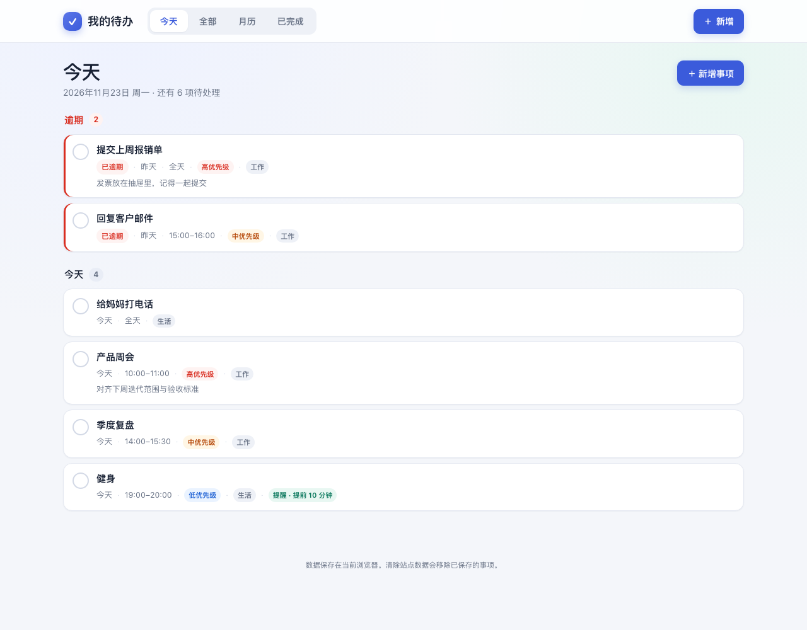

# 我的待办

一个单页的个人待办与日程应用：今天、全部、月历、已完成四个页面共用同一份事项数据。无需账号和后端，数据保存在当前浏览器的 `localStorage`。



## 运行

直接启动任意静态文件服务器即可（ES Modules 需要通过 HTTP 访问）：

```bash
python3 -m http.server 8000
# 打开 http://localhost:8000
```

也可以使用 `npm start`（同样运行上面的命令）。没有构建步骤，也不需要安装依赖。

## 功能

- **今天**：按「逾期」和「今天」分组展示未完成事项，可直接新增、勾选完成、打开详情。全天事项从次日零点起算逾期；有时间的事项在结束时间（未填结束时间时按开始时间）到达后算逾期。
- **全部**：查看全部未完成事项，包含未排期事项；支持标题/备注搜索，以及分类、优先级筛选，条件可组合、可一键清除。重复事项只展示每组中最早的一次。
- **月历**：按月查看安排，可切换月份或回到今天。点击日期查看当天事项，并从该日期新增。已完成事项会保留并显示完成状态。
- **已完成**：按完成时间从近到远展示，可打开详情、恢复为待办或删除。
- **事项字段**：标题（必填）、备注、日期、开始/结束时间、分类、优先级、重复、网页内提醒。
- **重复**：每天、每周（按首次日期的星期几）、每月（按首次日期的日号，短月自动排到该月最后一天，下月恢复原日号）。每次安排可单独完成、改期或删除；编辑或删除时可选择「仅本次」或「本次及以后」，之前的事项和完成记录保留。
- **提醒**：默认关闭，可选开始时、提前 10 分钟或提前 1 小时。仅网页打开时生效，每条提醒只显示一次；重新打开网页只安排之后的提醒。
- **持久化**：刷新或关闭后重新打开，事项与完成记录仍在。清除站点数据会移除已保存事项。

## 测试

核心日期、重复、逾期、筛选、存储与校验逻辑都有单元测试，使用 Node 内置测试运行器，无第三方依赖：

```bash
npm test
```

## 目录

```
index.html          页面外壳
styles.css          样式与响应式布局
js/app.js           页面渲染、表单、弹窗、提醒调度
js/dates.js         本地日期/时间工具
js/recurrence.js    重复规则展开
js/store.js         localStorage 读写与写操作
js/queries.js       各页面数据派生（逾期、排序、筛选等）
js/validation.js    表单校验
test/               Node 单元测试
```

## 浏览器

面向现代桌面与手机浏览器（Chrome、Safari、Edge、Firefox 的近两年版本）。日期、时间和时区均按浏览器当前时区处理。
