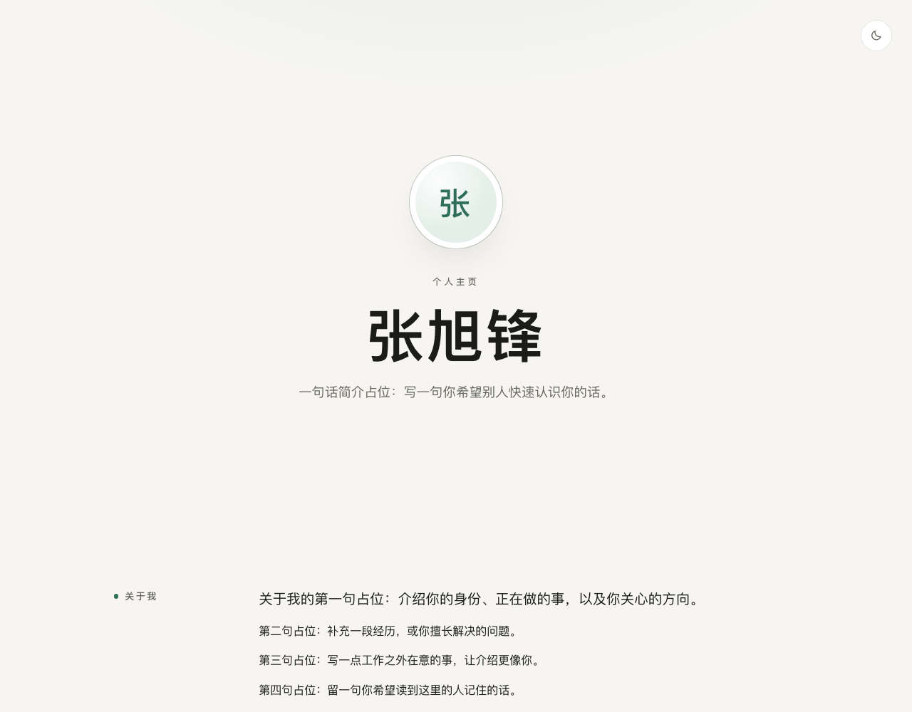

# 个人主页

张旭锋的个人主页：单页静态站，零依赖、零构建，不请求任何外部图片、字体或脚本。



## 运行

ES Modules 需要通过 HTTP 访问，不能直接双击打开 `index.html`。

```bash
cd apps/profile
python3 -m http.server 8000
# 打开 http://localhost:8000
```

也可以在本目录执行 `npm start`（同样使用 Python 静态服务器，无需安装依赖）。

## 测试

使用 Node 内置测试运行器，覆盖渲染输出、主题解析和外链属性：

```bash
cd apps/profile
npm test
# 或
node --test
```

仓库根目录的 `npm test` 也会执行这里的测试。

## 修改内容

文案和链接集中在 `content.js`：

- 姓名、头像占位字、一句话简介：`name`、`avatarInitial`、`tagline`
- 关于我：`about`（数组，每项一句，增删即可）
- 技能：`skills`（每组的 `title` 与 `items` 标签）
- 项目卡片：`projects`（`title`、`description`、`url`、`linkLabel`，可增删数组项）
- 联系方式：`contact.github` 与 `contact.email`
- 页脚说明：`footerNote`
- 页面标题与描述：`index.html` 中的 `<title>` 与 `<meta name="description">`

头像使用 CSS 绘制的圆形占位，不加载图片；换成照片时可把 `.avatar` 的背景改为本地图片，或改成 ``。

## 主题

首次访问跟随系统 `prefers-color-scheme`。右上角按钮切换浅色/深色，选择保存在 `localStorage` 的 `profile-theme` 键中，刷新后保持；存储不可用时不报错，只是不记忆选择。

## 结构

```text
index.html           页面外壳与首屏主题恢复
styles.css           极简样式、响应式布局与明暗主题变量
content.js           所有文案与链接
render.js            纯函数渲染层（输入数据，输出 HTML）
app.js               挂载页面、主题切换与持久化
test/render.test.js  node:test 单元测试
docs/screenshots/    PR 视觉证据
```
